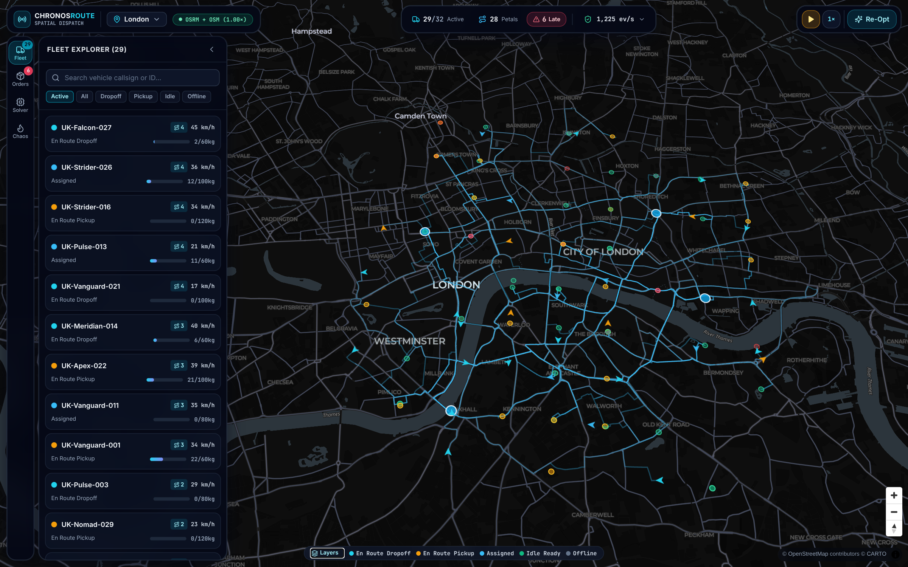
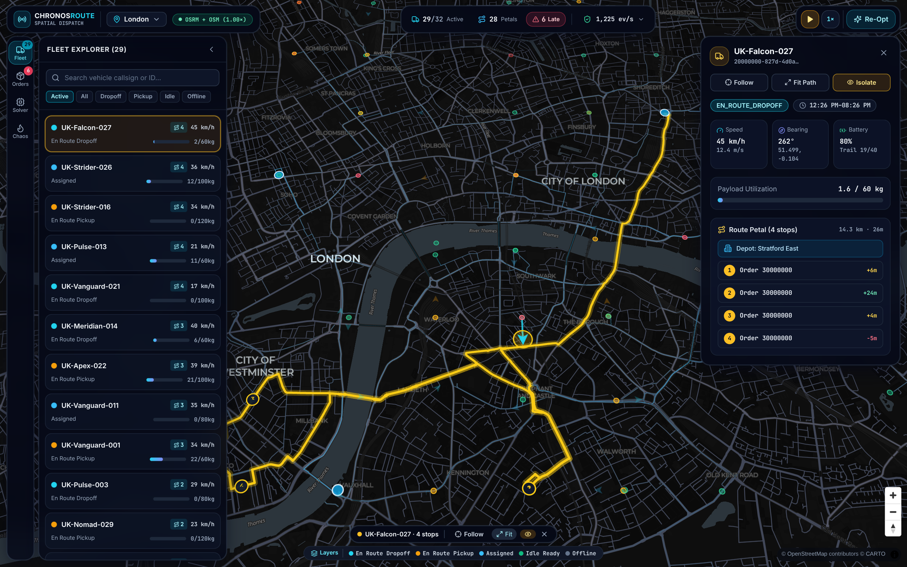
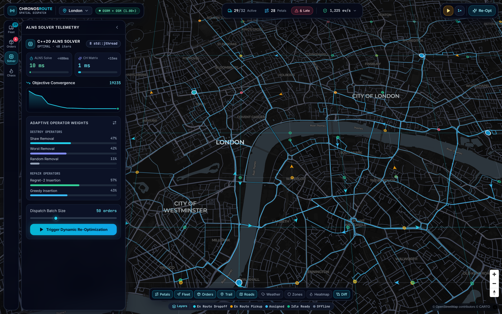
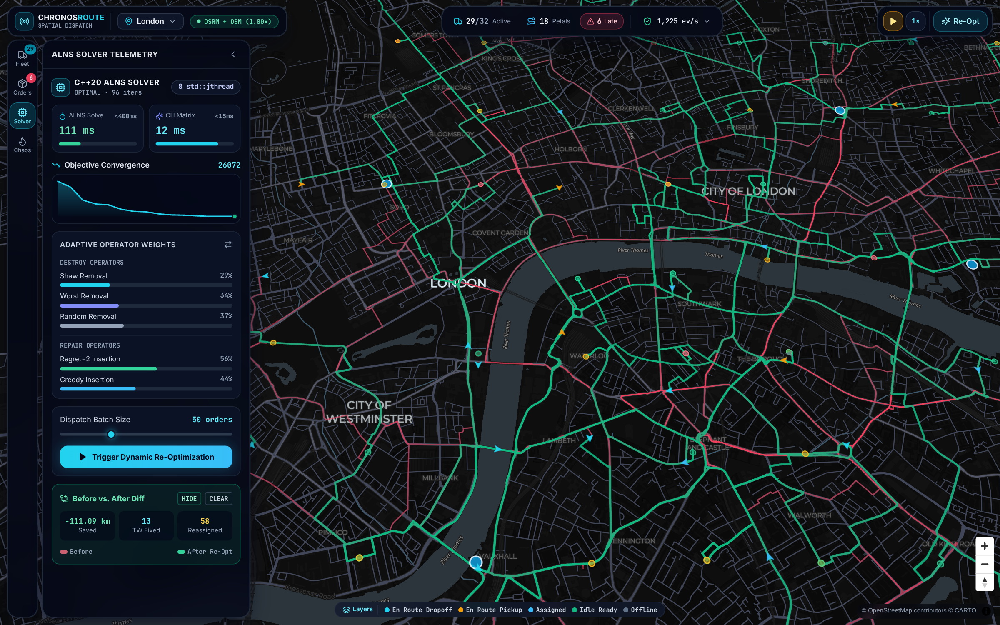

# ChronosRoute — Distributed Fleet Dispatch & Real-Time Vehicle Routing

[](LICENSE)
[](services/ingestion-py)
[](services/orchestrator-java)
[](services/solver-cpp)
[](db)
[](frontend)

**ChronosRoute** is a polyglot fleet dispatch and dynamic route-optimization engine built across five tiers—an interactive **React + MapLibre/deck.gl** geospatial command center, a **Python (FastAPI)** edge ingestion and ONNX ETA gateway, a **Java 21** virtual-thread dispatch orchestrator, a **C++20** multithreaded routing solver, and a **PostgreSQL/PostGIS + Redis** spatial-temporal store. It continuously plans and re-optimizes multi-stop delivery routes over real OpenStreetMap road networks as traffic, orders, and deadlines evolve.

---

## Showcase

| Citywide Street-Level Fleet & Petals | Selected Route Petal & Stop Inspector |
| :---: | :---: |
| [](assets/01_chronos_fleet_overview.png) | [](assets/02_chronos_selected_petal.png) |
| **Underlying OSM Road Graph & Live ALNS Solver** | **Dynamic Re-Optimization (Before vs. After Diff)** |
| [](assets/03_chronos_road_graph_alns.png) | [](assets/04_chronos_alns_reopt_diff.png) |

---

## The Routing Problem (CVRPTW)

Dispatching a live delivery fleet generalizes the classic **Traveling Salesperson Problem (TSP)** into the **Capacitated Vehicle Routing Problem with Time Windows (CVRPTW)**:

- **TSP** looks for a single minimum-cost Hamiltonian cycle visiting every stop once.
- **mTSP / VRP** partitions those stops across $`|K|`$ vehicles anchored at a hub (depot $`0`$), forming disjoint **"petals"**—one closed loop per vehicle.
- **CVRPTW** layers operational reality onto every petal: asymmetric street-network travel times $`t_{ij}`$ derived from OpenStreetMap / OSRM driving matrices, finite vehicle payload limits $`Q_k`$, delivery time windows $`[e_i, l_i]`$, and pickup-before-dropoff order precedence.

Given a directed road graph $`G = (V, A)`$ with hub $`0`$, stop set $`N = V \setminus \{0\}`$, and fleet $`K`$, let $`x_{ijk} \in \{0, 1\}`$ indicate whether vehicle $`k`$ traverses arc $`(i, j)`$, with arrival time $`a_{ik}`$, early waiting $`w_{ik} = \max(0, e_i - a_{ik})`$ and lateness $`\delta_{ik} = \max(0, a_{ik} + w_{ik} - l_i)`$:

$$
\min \sum_{k \in K} \left( \sum_{(i,j) \in A} (t_{ij} + \alpha\, d_{ij})\, x_{ijk} + \sum_{i \in N} (\beta\, w_{ik} + \lambda\, \delta_{ik}) + \lambda\, \delta^{\text{shift}}_k \right)
$$

subject to:
1. **Single visit:** Every stop is served exactly once: $`\sum_{k \in K}\sum_{j \in V} x_{ijk} = 1 \;\;\forall i \in N`$.
2. **Hamiltonian petals (flow conservation):** Each active vehicle departs and returns to the hub ($`\sum_j x_{0jk} = \sum_i x_{i0k} \le 1`$) and exits every stop it enters ($`\sum_i x_{ihk} = \sum_j x_{hjk}`$).
3. **Capacity:** Cumulative onboard load never exceeds $`Q_k`$ along vehicle $`k`$'s route.
4. **Time propagation:** Whenever $`x_{ijk} = 1`$, arrival satisfies $`a_{jk} \ge a_{ik} + w_{ik} + s_i + t_{ij}`$ (with service time $`s_i`$ and shift end $`T_k^{\max}`$).
5. **Pickup–dropoff precedence:** Paired stops $`(p, d)`$ must lie on the same vehicle petal with $`a_{pk} < a_{dk}`$.

Because CVRPTW is **NP-hard**, exact MILP solvers stall as stop counts grow and conditions shift mid-shift. ChronosRoute solves re-dispatch batches within a sub-500 ms budget using **Adaptive Large Neighborhood Search (ALNS)** (Shaw/Worst/Random destroy, Regret-2/Greedy repair, 2-Opt/Or-Opt local search, and Simulated Annealing) paired with $`O(1)`$ Savelsbergh backward-pass time-window slack checks—implemented both in the C++20 gRPC solver and locally in the interactive TypeScript simulation.

---

## Architecture & Modules

```text
[Interactive Web Command Center (React 19 · MapLibre GL · deck.gl · Local ALNS & OSRM)]
                                        │
[GPS Telemetry / Overpass OSM / OSRM / Open-Meteo]
                                        ▼
[Tier 1: Edge Ingestion & ONNX ETA Gateway (Python 3.12 · FastAPI · uvloop)]
          ├── Redis Streams (XADD) ──► [Tier 2: Dispatch Orchestrator (Java 21 · Spring Boot · Virtual Threads)]
          │                                     │  gRPC / Protobuf (450 ms deadline)
          │                                     ▼
          │                            [Tier 3: Parallel VRP Solver (C++20 · CSR Graph · ALT/CH · ALNS · ONNX)]
          └── asyncpg COPY / UNNEST ─► [Tier 4: Geospatial & Time-Series Store (PostgreSQL 18 + PostGIS 3.6 + Redis 7)]
```

- **`frontend/` (Interactive Simulation Dashboard):** React 19, TypeScript, Vite, MapLibre GL, and deck.gl across 6 metropolitan regions (London, Kuala Lumpur, Singapore, Berlin, San Francisco, Tokyo). Extracts strongly connected arterial OSM graphs (Tarjan's SCC + 2D crossing noding), calibrates regional speeds via OSRM `/table/v1/driving/`, caches graphs/routes in `IndexedDB`, solves multi-vehicle CVRPTW locally via ALNS, and hydrates exact street-following route polylines via OSRM `/route/v1/driving/`.
- **`services/ingestion-py/` (Edge Gateway & ETA Model):** FastAPI + `uvloop` async telemetry ingestion (`10,000`-item bounded queue, `500` items / `100 ms` micro-batch flusher), per-upstream circuit breakers (`open_meteo`, `osrm`, `overpass`) with degraded fallbacks, and a lightweight 2-layer ReLU MLP residual ETA model exported to ONNX.
- **`services/orchestrator-java/` (Fleet Dispatch Core):** Java 21 virtual threads with zero `synchronized` pinning (`ReentrantLock` + fair bulkhead semaphore) executing a 3-phase dispatch saga (`SELECT ... FOR UPDATE SKIP LOCKED` short transactions, non-transactional gRPC solver call, optimistic `@Version` retries, transactional outbox, and 24h idempotency).
- **`services/solver-cpp/` (Low-Latency Routing Engine):** C++20 gRPC server with lock-free double-buffered CSR road graphs (`std::atomic<std::shared_ptr<const Snapshot>>`, multi-point OSM `shape_points`), cache-aligned `std::jthread` work-stealing pool, 8-landmark ALT / Contraction Hierarchies shortest paths, exact Google Polyline5 reconstruction, parallel ALNS, and in-process ONNX Runtime inference.
- **`db/` (Spatial-Temporal Storage):** Flyway migrations `V1`–`V4` for PostGIS `GIST` spatial indexes, covering/partial dispatch queue indexes, `fillfactor = 80` HOT updates, and weekly range-partitioned telemetry tables with `BRIN` indexes.

Core engineering trade-offs are documented in [`docs/adr/`](docs/adr/):
- [ADR 0001](docs/adr/0001-cpu-bound-vrp-offload-cpp20-grpc.md) — Offloading VRP metaheuristics to C++20 via gRPC
- [ADR 0002](docs/adr/0002-preventing-double-dispatch-skip-locked-idempotency.md) — Double-dispatch prevention via `SKIP LOCKED` & idempotency
- [ADR 0003](docs/adr/0003-lock-free-double-buffering-traffic-graph.md) — Lock-free atomic double buffering for live traffic graphs
- [ADR 0004](docs/adr/0004-postgresql-partitioning-indexing-10m-telemetry.md) — Partition & index tuning for 10M+ telemetry rows

---

## Quickstart

### 1. Run the Interactive Simulation Dashboard (No Docker Required)

The web workspace runs cleanly in standalone simulation mode using live Overpass/OSRM street hydration (falling back gracefully offline):

```bash
cd frontend
npm install
npm run dev
```

### 2. Full-Stack Infrastructure & Polyglot Verification

```bash
# Boot PostgreSQL 18 + PostGIS 3.6 and Redis 7
make dev-up

# Regenerate Python / Java / C++ Protobuf & gRPC stubs
make proto

# Run verification suites across Python, Java, C++, and DB query-plan gates
make verify-all
```

*Note: Offline test targets run deterministically against in-memory Redis/Postgres stubs, offline Java test stubs, and canonical SQL `EXPLAIN` plan baselines when Docker services are not active.*

## License

MIT License — see [LICENSE](LICENSE).
